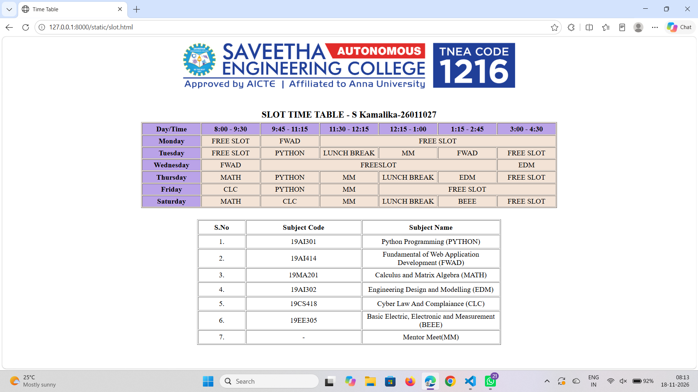
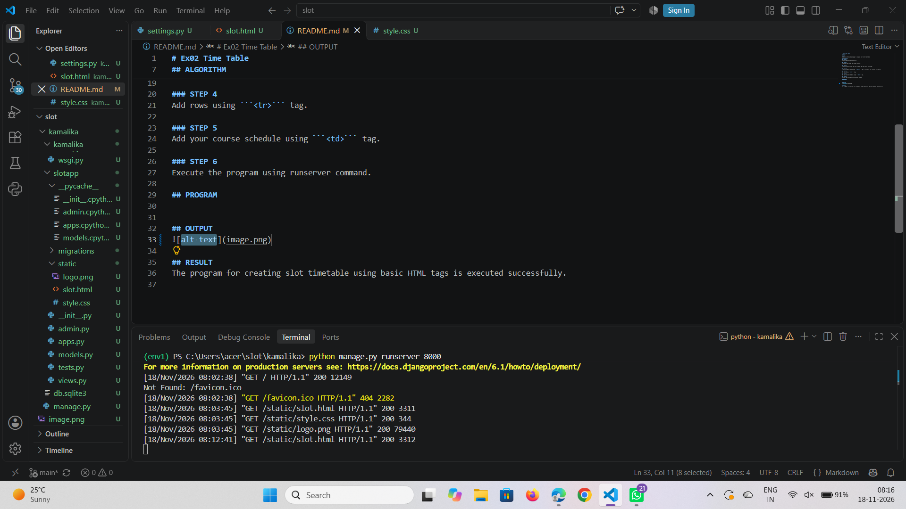

# Ex02 Time Table
## Date: 18/11/2026

## AIM
To write a html webpage page to display your slot timetable.

## ALGORITHM
### STEP 1
Create a Django-admin Interface.

### STEP 2
Create an App inside the Django project.

### STEP 2
Create a static folder uder the created App and insert HTML code.

### STEP 3
Create a simple table using ```<table>``` tag in html with the relevant attributes.

### STEP 4
Add rows using ```<tr>``` tag.

### STEP 5
Add your course schedule using ```<td>``` tag.

### STEP 6
Execute the program using runserver command.

## PROGRAM

slot.html

```
<html>
<head>
	<title>Time Table</title>
	<link rel="stylesheet" href="style.css">
</head>
<body>
    
    
    <table class="tabletime" align="center" border="1" cellspacing="2" cellpading="24">
      <caption align="center"><b>SLOT TIME TABLE - S Kamalika-26011027</b></caption>

    <tr  bgcolor="#baa3e8" align="center">
        <th >Day/Time</th>
        <th >8:00 - 9:30</th>
        <th >9:45 - 11:15</th>
        <th >11:30 - 12:15</th>
        <th >12:15 - 1:00</th>
        <th >1:15 - 2:45</th>
        <th >3:00 - 4:30</th>
    </tr>

    <tr align="center">
        <td bgcolor="#baa3e8" > <b>Monday</b></td>
        <td>FREE SLOT</td>
        <td >FWAD</td>
        <td colspan="4">FREE SLOT</td>
    </tr>

    <tr align="center">
        <td bgcolor="#baa3e8"><b>Tuesday</b></td>
        <td >FREE SLOT</td>
        <td >PYTHON</td>
        <td >LUNCH BREAK</td>
        <td >MM</td>
        <td >FWAD</td>
        <td >FREE SLOT</td>    
    </tr>

    <tr align="center">
        <td bgcolor="#baa3e8" ><b>Wednesday</b></td>
        <td>FWAD</td>
        <td colspan="4">FREESLOT</td>
        <td >EDM</td>    
    </tr>

    <tr align="center">
        <td bgcolor="#baa3e8"  > <b>Thursday</b> </td>
        <td >MATH</td>
        <td >PYTHON</td>
        <td>MM</td>
        <td>LUNCH BREAK</td>
        <td>EDM</td>
        <td>FREE SLOT</td>
  
    </tr >

        <tr align="center">
        <td bgcolor="#baa3e8" ><b>Friday</b></td>
        <td >CLC</td>
        <td >PYTHON</td>
        <td >MM</td>
        <td colspan="3" >FREE SLOT</td>
    </tr >
        <tr align="center">
        <td bgcolor="#baa3e8"  ><b>Saturday</b></td>
        <td>MATH</td>
        <td >CLC</td>
        <td>MM</td>
        <td>LUNCH BREAK</td>
        <td>BEEE</td>
        <td>FREE SLOT</td>
    </tr>
    </table>

    <table class="course" align="center" border="1" cellspacing="20" cellpading="24">
    <tr>
        <th >S.No</th>
        <th >Subject Code</th>
        <th >Subject Name</th>
    </tr>
    <tr align="center">
        <td >1.</td>
        <td >19AI301</td>
        <td >Python Programming (PYTHON)</td>
    </tr>
        <tr align="center">
        <td >2.</td>
        <td >19AI414</td>
        <td >Fundamental of Web Application Development (FWAD)</td>
    </tr>
        <tr align="center">
        <td >3.</td>
        <td >19MA201</td>
        <td >Calculus and Matrix Algebra (MATH)</td>
    </tr>
        <tr align="center">
        <td >4.</td>
        <td >19AI302</td>
        <td >Engineering Design and Modelling (EDM)</td>
    </tr >
        <tr align="center">
        <td >5.</td>
        <td >19CS418</td>
        <td >Cyber Law And Complaiance (CLC)</td>
    </tr>
        <tr align="center">
        <td >6.</td>
        <td >19EE305</td>
        <td >Basic Electric, Electronic and Measurement (BEEE)</td>
    </tr>
        <tr align="center">
        <td >7.</td>
        <td > - </td>
        <td >Mentor Meet(MM)</td>
    </tr>
    </table>
</body>
</html>
```
style.css

```
.img{
    width:50%;
    margin-left: 350px;
}
.timetable{
    background-color: #f3e3d6; 
    margin-bottom:25px; 
    margin-top:40px;
}
.timetable caption{
    font-size:20px; 
    margin-bottom: 5px;
}
.tabletime tr th{
    width: 125px;
    height: 25px;
}
.tabletime tr td{
    width: 125px;
    height: 25px;
}

.course tr td:nth-child(1){
width: 100px;
height: 30px;
}

.course tr td:nth-child(2){
width: 250px;
height: 30px;
}

.course tr td:nth-child(3){
width: 300px;
height: 30px;
}
.course tr th{
height: 30px;
}

```

## OUTPUT
Webpage:



Server Side:



## RESULT
The program for creating slot timetable using basic HTML tags is executed successfully.
